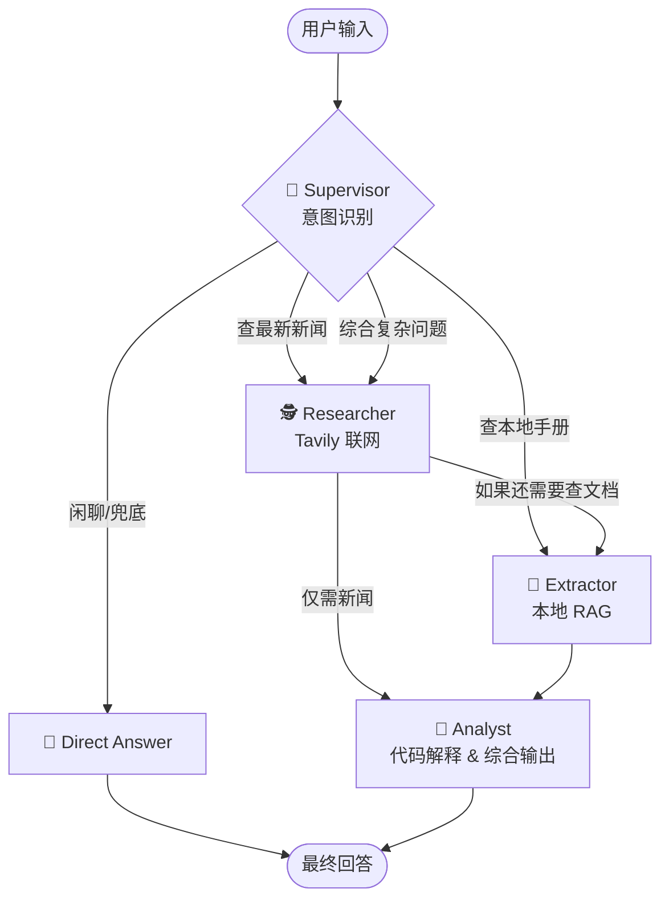

# 🤖 Multi-Agent Intelligent Consultant (多 Agent 智能顾问系统)

一个基于 **LangGraph**、**DeepSeek** 和 **本地 RAG** 构建的工业级多智能体协作系统。本系统模拟真实企业团队，通过“意图路由 + 多角色分工”架构，解决复杂的检索、计算与深度分析任务。

## ✨ 核心特性 (Features)

*   **👑 动态意图路由 (Dynamic Routing)**：摒弃死板的流水线，由 Supervisor 节点基于大模型进行意图识别，按需分发任务（闲聊兜底、纯联网、纯文档、综合）。
*   **🕵️ 多 Agent 协作 (Multi-Agent Collaboration)**：
    *   **Researcher**：负责联网抓取最新政策、新闻。
    *   **Extractor**：负责在本地 PDF 知识库中精准检索。
    *   **Analyst**：负责综合情报，并**自主调用 Python 代码解释器**完成精确计算（杜绝大模型数学幻觉）。
*   **📁 动态文档管理 (Dynamic Document Management)**：支持前端实时上传 PDF。内置 MD5 哈希去重机制，相同内容文档秒级复用已有向量库；若用户未上传，系统自动加载默认手册进行兜底。
*   **🛡️ 企业级工程架构**：全链路模块化设计（Core / Skills / Agents / Workflow），解耦大模型调用与业务逻辑，内置异常捕获与优雅降级。
*   **📝 可观测性 (Observability)**：全局日志系统，支持终端与文件双端记录，内置节点执行耗时追踪。
*   **💻 可视化界面**：基于 Streamlit 构建前端，实时流式展示 Agent 团队的协作进度。

## 🏗️ 系统架构 (Architecture)



## 🛠️ 技术栈 (Tech Stack)

| 类别 | 技术选型 | 作用说明 |
| :--- | :--- | :--- |
| **核心框架** | LangGraph, LangChain | 构建多 Agent 状态机、工具调用与复杂工作流编排 |
| **大语言模型** | DeepSeek-V3 (via OpenAI API) | 负责意图识别、任务决策、结果生成与代码编写 |
| **本地向量模型** | HuggingFace (`all-MiniLM-L6-v2`) | 将本地文档进行向量化处理，实现离线 Embedding |
| **本地数据库** | ChromaDB | 存储文档向量，支持毫秒级本地 RAG 语义检索 |
| **联网搜索** | Tavily API | 专为大模型设计的搜索引擎，提供实时、无污染的网页信息 |
| **前端界面** | Streamlit | 快速构建交互式 Web UI，支持流式展示 Agent 执行进度 |


## 📁 目录结构 (Project Structure)
## 📁 目录结构 (Project Structure)

```text
├── .env                  # API Keys 配置 (不提交至 Git)
├── app_ui.py             # Streamlit Web 前端启动入口
├── main.py               # 终端测试入口
├── core/                 # 核心配置模块
│   ├── config.py         # 大模型、Embedding 与 RAG 动态建库逻辑
│   ├── logger.py         # 全局日志系统与耗时追踪
│   └── state.py          # LangGraph 全局状态定义
├── skills/               # Agent 技能/工具库
│   ├── code_executor.py  # Python 代码沙盒执行工具
│   └── web_search.py     # Tavily 联网搜索工具
├── agents/               # 多智能体逻辑模块
│   ├── supervisor.py     # 调度员 (意图路由)
│   ├── researcher.py     # 情报专员 (联网搜索)
│   ├── extractor.py      # 数据专员 (本地 RAG)
│   ├── analyst.py        # 首席分析师 (计算与总结)
│   └── chatbot.py        # 兜底闲聊机器人
└── workflow/             # 编排模块
    └── graph.py          # LangGraph 状态图拓扑构建
```

## 🚀 快速开始 (Quick Start)

### 1. 环境准备
建议使用 `Python 3.11`。克隆项目并安装依赖：
```bash
git clone https://github.com/Lmq0/Multi-Agent-Intelligent-Consultant.git
cd Multi-Agent-Intelligent-Consultant
pip install -r requirements.txt
```

### 2. 配置环境变量
在项目根目录创建 `.env` 文件，填入你的 API 密钥：
```env
DEEPSEEK_API_KEY=sk-你的DeepSeek_Key
TAVILY_API_KEY=tvly-你的Tavily_Key
```

### 3. 准备本地知识库
- 准备一个测试用的 PDF 文件，命名为 `test_doc.pdf` 放在根目录（作为默认兜底文档，也可以留空）。
- 确保项目中包含本地 Embedding 模型文件夹 `my_local_model`（或在 `core/config.py` 中修改为你自己的模型路径）。

### 4. 启动应用
```bash
streamlit run app_ui.py
```
打开浏览器访问 `http://localhost:8501` 即可体验。

## 💡 进阶优化方向 (Roadmap)
- [ ] **上下文记忆 (Memory)**：引入 LangGraph Checkpointer，支持多轮对话上下文连贯。
- [ ] **多模态文档解析**：支持对包含复杂表格和图表的 PDF 进行结构化解析。
- [ ] **工具生态扩展**：接入 MCP (Model Context Protocol) 标准，动态加载外部工具。

## 🤝 贡献与交流
本项目为个人学习与工程实践 Demo，欢迎提交 Issue 或 Pull Request。
